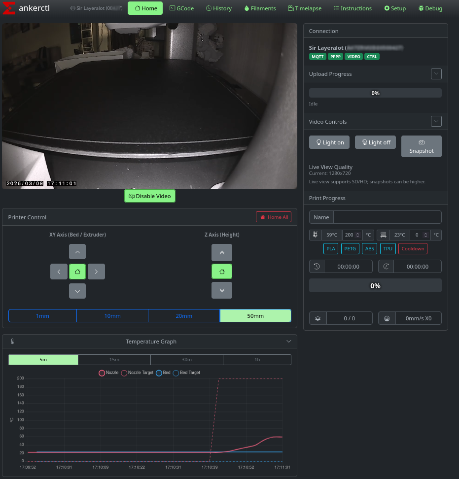

# ankerctl (Go Rewrite)

[](https://github.com/Django1982/ankerctl_go_remake/releases/tag/v1.0.0)
[](https://go.dev/)
[](LICENSE)
[](https://github.com/Django1982/ankerctl_go_remake/actions/workflows/ci.yml)
[](https://ghcr.io/django1982/ankerctl)

A Go reimplementation of [ankerctl](https://github.com/ankermake/ankermake-m5-protocol) -- a CLI and web UI for monitoring, controlling, and interfacing with AnkerMake M5 3D printers.

> **v1.0.0 — Feature parity achieved (2026-05-01).** All 17 migration phases are complete. The Go rewrite has reached full 1:1 feature parity with the Python original. See [`docs/MIGRATION_PLAN.md`](docs/MIGRATION_PLAN.md) for the migration history.



## Why Go?

- **Security** -- Strict type system, no dynamic eval, compiled binary
- **Performance** -- Single binary, fast startup, low memory footprint
- **Deployment** -- ~50 MB Docker image (vs ~300 MB Python), no runtime dependencies except ffmpeg
- **Concurrency** -- Native goroutines for MQTT, PPPP, and WebSocket streams

## Features

- Print directly from PrusaSlicer and its derivatives (SuperSlicer, Bamboo Studio, OrcaSlicer, etc.)
- Connect to AnkerMake M5 and AnkerMake APIs without using closed-source Anker software
- Send raw G-code commands to the printer (and see the response)
- Low-level access to MQTT, PPPP, and HTTPS APIs
- Send print jobs (G-code files) to the printer
- Stream camera image/video to your computer
- Monitor print status in real time
- Automatic **print history** (SQLite-backed log of every print with start time, duration, result)
- Automatic **timelapse** capture during prints -- assembled into MP4 video at the end (requires `ffmpeg`)
- **Push notifications** via [Apprise](https://github.com/caronc/apprise) for print start, finish, failure, and progress -- with optional live camera snapshots attached
- **Home Assistant MQTT Discovery** integration -- expose printer state, temperatures, progress, and light control directly to Home Assistant
- **Filament management** -- store filament profiles with preheat temperatures, swap wizard with guided workflow
- Optional **API key authentication** for all write operations
- **Debug tab** (enable with `ANKERCTL_DEV_MODE=true`) with state inspector, service health panel, event simulation, and log viewer
- **Bed Level Map** -- reads the 7x7 bilinear compensation grid from the printer, renders it as a colour-coded heatmap

## Requirements

| Dependency | Required | Notes |
|---|---|---|
| **ffmpeg** | For timelapse | Must be in `$PATH`. Docker image includes it. Install: `apt install ffmpeg` / `brew install ffmpeg` |
| Network access | Always | Printer and host must be on the same LAN segment |

> **No other runtime dependencies.** The binary embeds the entire web UI.

## Quick Start

### Docker (recommended)

```sh
docker run -d \
  --name ankerctl \
  --network host \
  -v ~/.ankerctl:/root/.ankerctl \
  -e ANKERCTL_HOST=0.0.0.0 \
  ghcr.io/django1982/ankerctl:latest
```

Navigate to [http://localhost:4470](http://localhost:4470) and upload your `login.json` or log in with email/password.

**Docker Compose:**

```yaml
services:
  ankerctl:
    image: ghcr.io/django1982/ankerctl:latest
    container_name: ankerctl
    network_mode: host
    restart: unless-stopped
    volumes:
      - ~/.ankerctl:/root/.ankerctl
      - captures:/captures
    env_file: .env

volumes:
  captures:
```

Copy `.env.example` to `.env` and adjust the values, then run:

```sh
docker compose up -d
```

> **Note:** `network_mode: host` is required for PPPP (UDP P2P) communication with the printer on the local network.

> **Firewall:** If ufw or another stateful firewall is enabled on the host, allow inbound UDP on **32100, 32108, and 32109**. ankerctl binds these as fixed local ports so conntrack can pass the printer's reply to a broadcast LanSearch. See [`docs/operations/firewall.md`](docs/operations/firewall.md) for the full rationale and `ufw allow` commands.

### Binary

Download the latest release for your platform from the [Releases](https://github.com/Django1982/ankerctl_go_remake/releases) page.

```sh
# Linux / macOS
chmod +x ankerctl-linux-amd64
./ankerctl-linux-amd64 webserver --listen 0.0.0.0:4470

# Windows
ankerctl-windows-amd64.exe webserver --listen 0.0.0.0:4470
```

### From Source

```sh
git clone https://github.com/Django1982/ankerctl_go_remake.git
cd ankerctl_go_remake
go build -o ankerctl ./cmd/ankerctl/
./ankerctl webserver
```

## Configuration

### Connect Your Printer

**Option 1 -- Direct login (recommended):**
Open [http://localhost:4470](http://localhost:4470), go to the Setup tab and log in with your AnkerMake email and password. No extra files needed.

**Option 2 -- Import `login.json` (offline / no account access):**
```sh
# Via Web UI: Setup tab → upload login.json
# Via CLI:
./ankerctl config import path/to/login.json
```

The `login.json` file can be exported from the AnkerMake slicer:
- **macOS:** `~/Library/Application Support/AnkerMake/AnkerMake_64bit_fp/login.json`
- **Windows:** `%APPDATA%\Roaming\eufyMake Studio Profile\cache\offline\user_info`
- **Linux (Wine):** `~/.wine/drive_c/users/<name>/AppData/Roaming/eufyMake Studio Profile/cache/offline/user_info`

### API Key

```sh
# Generate a random API key
./ankerctl config set-password

# Or set a specific key (minimum 16 characters)
./ankerctl config set-password my-secret-key

# Remove key (disable authentication)
./ankerctl config remove-password
```

For Docker, set `ANKERCTL_API_KEY` in your `.env` file.

**Using the key:**
- **Slicer:** Enter the key as the API Key in the printer settings (sent as `X-Api-Key` header)
- **Browser:** Append `?apikey=your-key` to the URL once -- a session cookie is set automatically
- **No key set** = no authentication (backwards compatible, default behavior)
- The WebUI is always readable (status, video, etc.) -- the key is only required for write operations

### Browser Login

Separate from the API key above, you can require a username/password login
for the whole WebUI by setting `ANKERCTL_WEB_USERNAME` and
`ANKERCTL_WEB_PASSWORD_HASH` (a bcrypt hash -- the same format Caddy's
`caddy hash-password` / `basic_auth` directive produces, so an existing
reverse-proxy hash can be reused directly). It sets a signed session cookie
after a normal form login, with brute-force lockout
(`ANKERCTL_WEB_LOGIN_MAX_ATTEMPTS` / `ANKERCTL_WEB_LOGIN_LOCKOUT_SECONDS`,
default 5 attempts / 5 minutes).

Use this instead of putting HTTP Basic Auth in front of ankerctl in your
reverse proxy. This app keeps several WebSockets open at once
(`/ws/mqtt`, `/ws/ctrl`, `/ws/pppp-state`, `/ws/video`) and polls a number of
JSON endpoints every time you switch tabs. Browsers cannot attach a cached
Basic Auth credential to a WebSocket handshake, and *any* `401` response
carrying `WWW-Authenticate` -- not just a page navigation, a background
XHR or WS handshake too -- re-triggers the browser's native login dialog.
With this much background traffic, that means a login prompt on almost
every click. A normal session cookie doesn't have that problem: it's sent
automatically on every request, including WebSocket upgrades.

The API key and the browser login are independent: the API key
authenticates individual write requests from machines (slicers, scripts);
the browser login authenticates a human's whole session. You can use
either, both, or neither.

### Printing from PrusaSlicer

ankerctl is compatible with PrusaSlicer and its derivatives (OrcaSlicer, SuperSlicer, Bamboo Studio). Configure a new printer with:
- **Host:** `localhost` (or your server IP)
- **Port:** `4470`
- **API Key:** your configured key (if set)

Use "Send and Print" to upload and immediately start printing.

### Environment Variables

See [`.env.example`](.env.example) for a complete, commented template.

| Variable | Default | Description |
|----------|---------|-------------|
| **Server** | | |
| `ANKERCTL_HOST` / `FLASK_HOST` | `127.0.0.1` | Bind address |
| `ANKERCTL_PORT` / `FLASK_PORT` | `4470` | Listen port |
| `FLASK_SECRET_KEY` | *(auto)* | Session cookie secret |
| `PRINTER_INDEX` | `0` | Active printer index (0-based) |
| **Upload** | | |
| `UPLOAD_MAX_MB` | `2048` | Max upload size in MB |
| `UPLOAD_RATE_MBPS` | `10` | Upload speed (Mbit/s): 5, 10, 25, 50, 100 |
| **Security** | | |
| `ANKERCTL_API_KEY` | *(unset)* | API key for write operations |
| `ANKERCTL_WEB_USERNAME` | *(unset)* | Browser login username |
| `ANKERCTL_WEB_PASSWORD_HASH` | *(unset)* | Browser login password (bcrypt hash, same format as Caddy's `basic_auth`) |
| `ANKERCTL_WEB_LOGIN_MAX_ATTEMPTS` | `5` | Failed login attempts before lockout |
| `ANKERCTL_WEB_LOGIN_LOCKOUT_SECONDS` | `300` | Lockout duration in seconds |
| **Features** | | |
| `ANKERCTL_DEV_MODE` | `false` | Enable debug endpoints |
| `ANKERCTL_LOG_DIR` | *(unset)* | Log file directory |
| **Apprise** | | |
| `APPRISE_ENABLED` | `false` | Enable push notifications |
| `APPRISE_SERVER_URL` | *(unset)* | Apprise API server URL |
| `APPRISE_KEY` | *(unset)* | Notification key/ID |
| `APPRISE_TAG` | *(unset)* | Tag filter |
| `APPRISE_EVENT_PRINT_STARTED` | `true` | Notify on print start |
| `APPRISE_EVENT_PRINT_FINISHED` | `true` | Notify on print finish |
| `APPRISE_EVENT_PRINT_FAILED` | `true` | Notify on print failure |
| `APPRISE_EVENT_GCODE_UPLOADED` | `true` | Notify on G-code upload |
| `APPRISE_EVENT_PRINT_PROGRESS` | `true` | Notify on progress |
| `APPRISE_PROGRESS_INTERVAL` | `25` | Progress interval (%) |
| `APPRISE_PROGRESS_INCLUDE_IMAGE` | `false` | Attach camera snapshot |
| `APPRISE_PROGRESS_MAX` | `0` | Override progress scale |
| `APPRISE_SNAPSHOT_QUALITY` | `hd` | Snapshot quality: sd, hd, fhd |
| `APPRISE_SNAPSHOT_FALLBACK` | `true` | Use G-code preview if live fails |
| `APPRISE_SNAPSHOT_LIGHT` | `false` | Turn on light for snapshot |
| **History** | | |
| `PRINT_HISTORY_RETENTION_DAYS` | `90` | Days to keep history |
| `PRINT_HISTORY_MAX_ENTRIES` | `500` | Max history entries |
| **Timelapse** | | |
| `TIMELAPSE_ENABLED` | `false` | Enable timelapse capture |
| `TIMELAPSE_INTERVAL_SEC` | `30` | Seconds between frames |
| `TIMELAPSE_MAX_VIDEOS` | `10` | Max videos to keep |
| `TIMELAPSE_SAVE_PERSISTENT` | `true` | Save videos persistently |
| `TIMELAPSE_CAPTURES_DIR` | `/captures` | Video storage directory |
| `TIMELAPSE_LIGHT` | *(unset)* | Light mode: `snapshot` or `session` |
| **Home Assistant** | | |
| `HA_MQTT_ENABLED` | `false` | Enable HA MQTT Discovery |
| `HA_MQTT_HOST` | `localhost` | MQTT broker host |
| `HA_MQTT_PORT` | `1883` | MQTT broker port |
| `HA_MQTT_USER` | *(unset)* | MQTT username |
| `HA_MQTT_PASSWORD` | *(unset)* | MQTT password |
| `HA_MQTT_DISCOVERY_PREFIX` | `homeassistant` | HA discovery prefix |
| `HA_MQTT_TOPIC_PREFIX` | `ankerctl` | State topic prefix |

## Development

```sh
# Build
go build -o ankerctl ./cmd/ankerctl/

# Run all tests
go test ./...

# Run tests for a specific package
go test ./internal/crypto/...

# Vet
go vet ./...
```

See the [Development Guide](docs/wiki/Development-Guide.md) for architecture details and contribution guidelines, or the [Migration Plan](docs/MIGRATION_PLAN.md) for the historical roadmap.

## Project Structure

```
cmd/ankerctl/           CLI entry point (cobra)
internal/
  config/               Configuration management
  crypto/               AES-256-CBC, ECDH, checksums
  db/                   SQLite database layer
  mqtt/protocol/        MQTT message types and packet structures
  mqtt/client/          MQTT client (Anker broker connection)
  pppp/protocol/        PPPP packet types (UDP P2P)
  pppp/client/          PPPP API, channels, file transfer
  pppp/crypto/          PPPP-specific crypto (curse/decurse)
  httpapi/              Anker Cloud HTTP API client
  service/              Service framework + all background services
  web/                  HTTP server, routes, templates
  web/handler/          HTTP handler functions
  web/ws/               WebSocket endpoint handlers
  web/middleware/        Auth, security headers, rate limiting
  notifications/        Apprise notification client
  gcode/                GCode parsing (time patching, layer count)
  model/                Data models (Config, Account, Printer)
  util/                 Shared utilities
  logging/              Structured logging setup
static/                 Frontend files (HTML/JS/CSS, unchanged from Python)
```

## Dependencies

| Package | Purpose |
|---------|---------|
| [chi/v5](https://github.com/go-chi/chi) | HTTP router |
| [gorilla/websocket](https://github.com/gorilla/websocket) | WebSocket |
| [modernc.org/sqlite](https://pkg.go.dev/modernc.org/sqlite) | SQLite (CGO-free) |
| [paho.mqtt.golang](https://github.com/eclipse/paho.mqtt.golang) | MQTT client |
| [cobra](https://github.com/spf13/cobra) | CLI framework |
| [google/uuid](https://github.com/google/uuid) | UUID generation |

## Legal

This project is licensed under the [GNU General Public License v3.0](LICENSE).

This project is **NOT** endorsed, affiliated with, or supported by AnkerMake. All information found herein is gathered entirely from reverse engineering using publicly available knowledge and resources.

The goal of this project is to make the AnkerMake M5 usable and accessible using only Free and Open Source Software (FOSS).

Based on the original [ankermake-m5-protocol](https://github.com/ankermake/ankermake-m5-protocol) by Christian Iversen, copyright 2023, licensed under GPLv3.

Some icons from [IconFinder](https://www.iconfinder.com/iconsets/3d-printing-line), licensed under [Creative Commons](https://creativecommons.org/licenses/by/3.0/).
